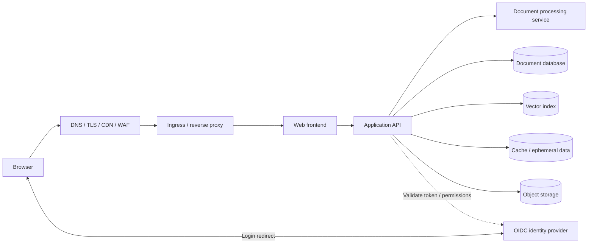
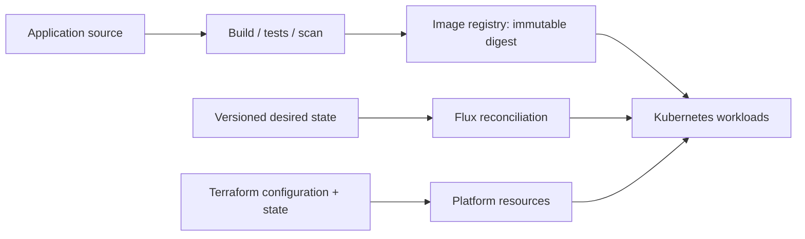

# Architecture and technology map

This is optional self-study using public tools and synthetic examples. There are no submissions, deadlines, company accounts, or production tasks. The diagrams are teaching models, not TalkingTree deployment diagrams.

## What transfers to TalkingTree

The technology names below reflect a technology-level inventory. Versions, deployment placement, access rules, service relationships, and the currently active production topology are deliberately not represented. No internal configuration or application code is included.

| Technology area | Relevant technologies | What to understand | Training treatment |
| --- | --- | --- | --- |
| Applications | Next.js/Node.js, FastAPI/Python, Flask-based document processing | Build artifacts, runtime configuration, dependency health, request timeouts, temporary files | A tiny original HTTP service teaches packaging and health; it does not reproduce any product workflow |
| Application data | MongoDB, Qdrant, Valkey, S3-compatible object storage | Durable state, indexes, caches, object keys, credentials, restore boundaries | Synthetic data and optional [stateful exercises](stateful-services.md) |
| Containers | Docker, Compose, containerd | Image versus running container, networks, volumes, runtime ownership | [Containers lab](../labs/01-containers/); K3s uses its own runtime |
| Cluster delivery | K3s, Kubernetes, Flux, Kustomize, Helm | Desired state, controllers, health, drift, release recovery | [K3s](../labs/03-k3s/) and [Flux](../labs/04-flux/) on a local disposable cluster |
| Platform resources | Terraform; cloud networking, compute, registries, storage, identity | Plans, state, ownership, dependency graphs | [Terraform lab](../labs/02-terraform/) uses local resources; cloud services are reading only |
| Identity and edge | Auth0 OIDC/OAuth, DNS, TLS, CDN/WAF, Cloudflare, Traefik reverse proxy | Authentication versus authorization, redirects, trust boundaries, origin health | [Routing and local DNS lab](../labs/07-routing-dns/README.md) and [optional personal identity study](identity.md); no public hostname required |
| Cluster extensions | cert-manager, External Secrets Operator, SOPS, Flux image automation, Traefik | Controllers that manage certificates, secrets, images, and routing | [Delivery reading](delivery.md); these are not all installed by the labs |
| Operations | Linux/systemd/cgroups, logs, monitoring and backups | Ownership, limits, evidence, alert meaning, recovery | [Foundations](foundations.md) and [practice SOPs](../sops/README.md) |

Traefik routes incoming requests to backends using host/path rules and optional middleware. The [routing guide](routing-and-dns.md) explains its relationship to DNS and TLS. The standalone Compose lab runs Traefik and a local CoreDNS teaching server; CoreDNS here is a training substitute, not a statement about company DNS hosting. Lab 03 keeps bundled K3s ingress disabled so its deployment exercise remains separate.

## A generic application request

This drawing combines common concepts for discussion. It does not assert that each request traverses every component or that an API calls an identity provider for every request. JWT verification commonly uses cached public signing keys. A browser session, an API access token, an object storage signature, and an infrastructure credential each grant different authority.

Trace one synthetic upload on paper: which component authorizes it, which stores bytes, which stores metadata, and what happens if metadata succeeds while the byte write fails? Then trace a download and identify where authorization must be checked again. A green process check cannot establish these behaviors.

## A generic delivery path

Define one owner for each resource. For example, Terraform might create a machine while Flux owns workloads within its cluster. Terraform and Flux should not continuously rewrite the same Deployment. Registry retention, image availability, database compatibility, and credentials all affect whether a rollback will work.

## Cloud vocabulary without cloud provisioning

The platform inventory includes AWS service families and Cloudflare/Auth0 configuration. These names are useful vocabulary, not instructions to create resources. The labs contain no AWS credentials or cloud deployment path. Local simulations do not reproduce managed-service security, resilience, or billing behavior.

| Cloud concepts encountered in infrastructure code | Local learning equivalent | Important gap |
| --- | --- | --- |
| VPC, subnets, security groups, EC2, IAM, SSM | VM, container networks, firewall policy, Linux users, process supervisor | A Docker network is not a VPC; root access is not an IAM role |
| ECR | Local image store or local registry | Registry authentication, regional availability, and retention need separate study |
| S3, DocumentDB, Valkey | Local object store, MongoDB, Valkey | S3-compatible and MongoDB-compatible describe interfaces, not full behavior equivalence |
| CloudFront, WAF, ACM, Route 53; Cloudflare DNS/edge | Local reverse proxy, explicit routing, local TLS concepts | No public DNS, certificate automation, CDN cache, or DDoS service is required |
| Secrets Manager, KMS | Local ignored secrets and SOPS/age concepts | A local key is not managed key custody, rotation, or access auditing |
| Backup, CloudWatch, SNS | Restore drill, local logs/metrics, a written alert | Local copies share the machine's failure domain |
| Lambda, SES | Function/job and notification concepts, paper exercise | No external execution or email delivery is needed |

Read the official [AWS service overview](https://docs.aws.amazon.com/whitepapers/latest/aws-overview/introduction.html) and [Cloudflare fundamentals](https://developers.cloudflare.com/fundamentals/) to connect the vocabulary. Avoid free-trial cloud provisioning for this track: it is unnecessary for the exercises.

Primary references: [Docker Compose](https://docs.docker.com/compose/), [K3s overview](https://docs.k3s.io/), [Flux concepts](https://fluxcd.io/flux/concepts/), and [Terraform introduction](https://developer.hashicorp.com/terraform/intro).
