# Traefik, DNS, and local domain management

Traefik is a reverse proxy and load balancer: clients connect to it, and it forwards selected requests to application processes. It is a relevant technology to study for TalkingTree. The examples here are original training configurations, not company routes or infrastructure diagrams. Work through them on your own machine or disposable VM, with synthetic data and no company account.

The [routing and DNS lab](../labs/07-routing-dns/README.md) runs Traefik, two toy backends, and a small authoritative DNS server using Docker Compose. It needs no registered domain, hosted service, payment method, or access to company DNS. Tool/image downloads and running containers still use your own machine's disk, bandwidth, and electricity. All exercises are optional; there is no submission or evaluation.

## Follow a request through the layers

```mermaid
flowchart LR
  Client[Client] --> DNS[DNS lookup: name to address]
  DNS --> Connect[TCP connection to address and port]
  Connect --> Entry[Traefik entryPoint]
  Entry --> TLS[HTTPS: TLS handshake and SNI]
  TLS --> Router[HTTP router: Host and path rule]
  Router --> Middleware[Optional middleware]
  Middleware --> Service[Traefik service: backend selection]
  Service --> Backend[Application process]
```



For plain HTTP, omit the TLS step. DNS lookup and HTTP forwarding are separate operations. An address record does not create a proxy route; a proxy route does not create a DNS record. DNS A/AAAA and CNAME records also do not encode the HTTP port: the client gets it from the URL or its scheme's default. The lab uses explicit ports, such as `http://notes.onboarding.test:18085/`.

| Traefik term | What it controls | Training example |
| --- | --- | --- |
| EntryPoint | A listening address/port | An HTTP listener inside the container, published only to loopback port `18085` |
| Router | Which requests select a route | ``Host(`notes.onboarding.test`)`` selects the notes backend |
| Middleware | Request/response processing attached to a route | Optional extension: add a response header; other common uses include redirects and path rewriting |
| Service | Where matching traffic is forwarded | A load balancer pointing at one or more backend URLs |
| Provider | Where Traefik obtains routing configuration | Files in this lab; Kubernetes resources in a cluster deployment |

EntryPoints belong to install configuration. Routers, middleware, services, and certificates are routing configuration. The lab's [file provider](https://doc.traefik.io/traefik/reference/install-configuration/providers/others/file/) lets you inspect that configuration without giving Traefik access to a Docker socket. See the official [EntryPoint](https://doc.traefik.io/traefik/reference/install-configuration/entrypoints/), [router rule](https://doc.traefik.io/traefik/reference/routing-configuration/http/routing/rules-and-priority/), [middleware](https://doc.traefik.io/traefik/reference/routing-configuration/http/middlewares/overview/), and [service](https://doc.traefik.io/traefik/reference/routing-configuration/http/load-balancing/service/) references.

## Manage a domain without buying one

Use `onboarding.test` as a local practice zone. The `.test` namespace is [reserved for testing](https://www.rfc-editor.org/rfc/rfc6761.html); it does not need registration and is not publicly delegated. It will not resolve through a normal public resolver. The lab sends queries directly to its own CoreDNS instance at `127.0.0.1:15353`. CoreDNS is a teaching substitute here; its use does not describe TalkingTree's DNS implementation.

| Role | Responsibility |
| --- | --- |
| Registry / registrar | The registry maintains a public suffix's registrations; a registrar is the service through which a registrant manages a registration and its nameserver delegation |
| Authoritative DNS server | Publishes the records for a zone it serves |
| Parent delegation | NS records in the parent direct resolvers to the child zone's authorities; glue addresses are needed in relevant cases |
| Recursive resolver | Follows referrals and caches answers for clients |
| Client / stub resolver | Asks its configured resolver for an answer |

The lab owns a local zone file; it does not simulate a registrar or a root/parent delegation chain. Changing a record and changing a delegation have different effects. A hosted DNS provider and a registrar can be separate organizations. Read [DNS concepts and zones](https://www.rfc-editor.org/rfc/rfc1034.html) for the protocol model.

| Record / field | Purpose | What to practice |
| --- | --- | --- |
| A | Name to IPv4 address | Point a toy hostname at `127.0.0.1` |
| AAAA | Name to IPv6 address | Understand that an unreachable published IPv6 address can affect clients even when IPv4 works |
| CNAME | Alias to another DNS name | Follow the alias to its final address; it is not an HTTP redirect |
| TXT | Text attached to a name | Store a synthetic ownership-verification string; DNS is not secret storage |
| MX | Mail exchanger name and preference | Inspect the record's meaning; no mail server or email delivery is needed |
| NS | Authoritative nameserver names | Inspect the zone's authorities and discuss parent delegation |
| SOA | Zone authority metadata and timers | Identify the serial and negative-cache-related fields |
| TTL | Cache lifetime in seconds | Compare a fresh authoritative answer with a cached one conceptually |

Record formats are described in [RFC 1035](https://www.rfc-editor.org/rfc/rfc1035.html), with IPv6 AAAA records in [RFC 3596](https://www.rfc-editor.org/rfc/rfc3596.html). A traditional CNAME cannot coexist with other ordinary records at the same name. The zone apex needs SOA and NS records, so a standard CNAME is unsuitable there. Some managed providers offer flattening/alias features with provider-specific behavior; those are not additional standard CNAME semantics. See [common DNS configuration errors](https://www.rfc-editor.org/rfc/rfc1912.html).

The lab publishes A, CNAME, TXT, NS, and SOA records. AAAA and MX are reading topics, with no IPv6 listener or mail service required. After starting the lab, inspect records explicitly:

```bash
dig @127.0.0.1 -p 15353 onboarding.test SOA +norecurse
dig @127.0.0.1 -p 15353 onboarding.test NS +norecurse
dig @127.0.0.1 -p 15353 notes.onboarding.test A +norecurse
dig @127.0.0.1 -p 15353 www.onboarding.test CNAME +norecurse
dig @127.0.0.1 -p 15353 _verification.onboarding.test TXT +norecurse
dig @127.0.0.1 -p 15353 missing.onboarding.test A +norecurse
```

Look at the status, authoritative-answer (`aa`) flag, answer section, TTL, and authority section. `NXDOMAIN` means the queried name does not exist; `NOERROR` with no requested record can instead mean the name exists but lacks that record type. Negative answers can also be cached; the distinction is explained in [RFC 2308](https://www.rfc-editor.org/rfc/rfc2308.html).

These commands do not change your operating system's resolver. The lab requires no `/etc/hosts` edit or replacement of your machine's DNS settings.

## Separate DNS checks from proxy checks

To test the proxy independently of normal name resolution:

```bash
curl --noproxy '*' --resolve notes.onboarding.test:18085:127.0.0.1 \
  http://notes.onboarding.test:18085/
```

`--resolve` supplies curl with an address for that hostname/port pair. It **bypasses DNS for that connection**, so a successful request is evidence about routing and the backend, not evidence that your DNS records work. Use `dig` separately. The [curl name-resolution guide](https://everything.curl.dev/usingcurl/connections/name.html) also explains why setting an HTTP `Host` header alone does not set HTTPS SNI.

The lab's `www.onboarding.test` CNAME points at `notes.onboarding.test`, but a request to the `www` URL still carries `www.onboarding.test` as its HTTP Host. It does not match a router that accepts only `notes.onboarding.test`. Compare those requests to see why a DNS alias alone does not make an application accept another hostname.

With HTTPS, the TLS handshake occurs before the HTTP request. SNI identifies the desired server name during that handshake; the certificate must cover the URL's hostname and be trusted by the client. The subsequent HTTP Host/authority selects an HTTP route. A successful certificate check does not establish that the selected application is healthy.

The lab's optional HTTPS exercise uses a short-lived self-signed certificate on `127.0.0.1:18443`. Trust it for an individual curl command with `--cacert` as documented in the lab. Do not install a trust root into your operating system or browser. No public ACME certificate is requested for `.test`.

For public-certificate reading, [Let's Encrypt challenges](https://letsencrypt.org/docs/challenge-types/) distinguish HTTP-01, which demonstrates control through an HTTP endpoint on port 80, from DNS-01, which demonstrates control using `_acme-challenge` TXT records and supports wildcard names. DNS-01 requires control of suitable DNS records, even if the application itself is private. Public DNS credentials and certificate issuance are outside this local lab.

## Diagnose the first failing boundary

| Symptom | Inspect first | What it does and does not establish |
| --- | --- | --- |
| DNS `NXDOMAIN` | Exact name, selected DNS server, zone data, negative cache | Name resolution failed; Traefik has not received an HTTP request from that lookup |
| Connection refused / timeout | Target address/port, listener, container state, firewall | Transport failed before a useful HTTP response |
| TLS trust / hostname error | URL name, SNI, certificate SANs, expiry, client trust | TLS identity verification failed before the HTTP route can be assessed |
| HTTP 404 | Response source, Host/path rule, entryPoint, loaded configuration | A request reached an HTTP server; it may be Traefik's unmatched-route response or an application 404 |
| HTTP 502 / 503 | Proxy logs, service target, backend port, backend state | A route may match while forwarding fails or no backend is available; an application can also return these codes |
| HTTP 200 | Response body and intended behavior | The selected request succeeded; other routes and authenticated workflows still need their own checks |

Read proxy and backend logs together. Avoid diagnosing from a status code alone. In the lab, compare a request to an unknown Host with a request to a configured route whose backend has been stopped, then restore that backend and verify the same URL.

## Practice a DNS change and rollback

Use only the local training zone for these steps; follow the lab's exact editing/reload instructions.

1. Record the affected name/type, current value and TTL, SOA serial, intended result, and rollback value in your private notes. Keep a copy of the current zone.
2. Change one synthetic record. For file-based reloads, increment the SOA serial. CoreDNS's [file plugin](https://coredns.io/plugins/file/) normally detects zone changes using that serial.
3. Query the authoritative server directly. Check the new serial and affected answer, then confirm unaffected names still answer as expected.
4. Verify the proxy separately using the intended Host and path. Record which checks used real DNS and which used curl's override.
5. Restore the old record value with a **newer** serial and verify again. Restoring an old file unchanged can restore an old serial and prevent the intended reload.

On a real cached DNS path, lowering TTL just before a change cannot remove copies already cached with the old TTL. Plan the lower TTL at least the prior cache lifetime ahead, preserve the previous destination while caches expire, and account for negative caching. Rollback also takes time for cached clients. This lab's direct authoritative queries avoid a recursive cache, so they do not demonstrate Internet-wide cache expiry.

## Connect this to Kubernetes and Flux

An Ingress is desired routing state; an Ingress controller interprets it and configures a proxy. `ingressClassName` selects the intended class. A Kubernetes Service selects ready workload endpoints; a Traefik service is the proxy's backend-selection configuration. These are related concepts with different configuration objects. See [Kubernetes Ingress](https://kubernetes.io/docs/concepts/services-networking/ingress/).

K3s normally packages Traefik, but [lab 03](../labs/03-k3s/README.md) explicitly disables that bundled controller to keep its port-forwarding exercise focused. Lab 07 runs standalone Traefik in Compose; it does not add an ingress controller to the K3s cluster. Applying an Ingress object to the existing lab cluster would not create a working proxy route by itself. K3s's [networking services guide](https://docs.k3s.io/networking/networking-services) covers its packaged controller.

For a future cluster extension, first choose and install a controller, configure its IngressClass and loopback exposure, then declare the routing objects. Flux can reconcile reviewed controller/chart and route configuration after that ownership is defined. Certificate automation, DNS record automation, proxy routing, and application rollout are separate responsibilities: decide which controller owns each before combining them.
